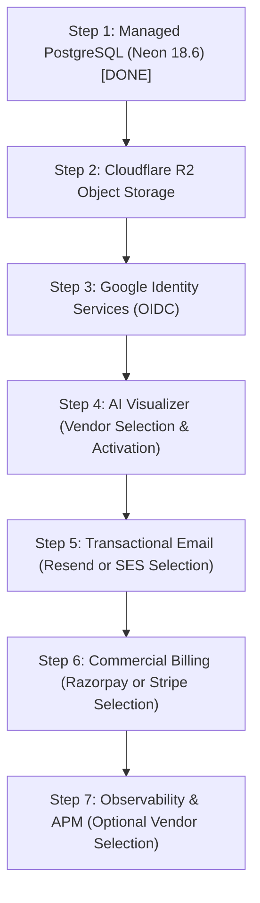

# Final Provider Activation Sequence & Runbook
## Elégance — Interior Designer Platform

This runbook establishes the strict category-based sequential procedure for activating and validating real external cloud service providers.

---

## Step 1: Managed PostgreSQL 18.6 (Neon)
*Current Status: COMPLETED & CLOSED (Phase 15A)*

1. **Configure Secret Locally**: In `.env.local`, set `SPRING_DATASOURCE_URL`, `SPRING_DATASOURCE_USERNAME`, `SPRING_DATASOURCE_PASSWORD`.
2. **Start**: Start Spring Boot backend against Neon connection string.
3. **Health**: Query `GET /actuator/health` -> verify `"database": { "status": "UP" }`.
4. **Functional Smoke**: Execute clean Flyway migration V001..V040. Verify 59 tenant tables with forced RLS.
5. **Security Test**: Verify cross-studio RLS isolation (0% cross-tenant data leak).
6. **Failure Test**: Disconnect network / supply invalid credentials -> confirm fail-closed rejection without credentials leaked in logs.
7. **Mark Live Validated**: Update `PROVIDER_ACTIVATION_REGISTER.md` -> `LIVE PROVIDER VALIDATION COMPLETE`.

---

## Step 2: Cloudflare R2 Object Storage
*Current Status: Pre-flight Contract Verified (8/8 PASS); Pending Credentials*

1. **Configure Secret Locally**: In `.env.local`, set `S3_ENDPOINT`, `S3_ACCESS_KEY_ID`, `S3_SECRET_ACCESS_KEY`, `S3_BUCKET_PRIVATE`, `S3_BUCKET_PUBLIC`.
2. **Start**: Boot backend with `MEDIA_STORAGE_PROVIDER=S3_COMPATIBLE`.
3. **Health**: Run `powershell -ExecutionPolicy Bypass -File scripts/verify-r2-live-integration.ps1 -RequireLive`.
4. **Functional Smoke**:
   - Create upload intent -> receive presigned PUT URL.
   - Upload sample interior photo to quarantine prefix `pending/`.
   - Confirm upload -> ClamAV scan -> EXIF stripping -> WebP derivative generation -> promotion to `studio/`.
5. **Security Test**: Verify private original cannot be read without presigned token; verify public derivative includes `Cache-Control: public, max-age=31536000, immutable`.
6. **Failure Test**: Upload EICAR standard antivirus test string -> verify ClamAV flags malware, deletes quarantine object, and returns HTTP 422 `MALWARE_DETECTED`.
7. **Mark Live Validated**: Update register -> `LIVE PROVIDER VALIDATION COMPLETE`.

---

## Step 3: Google Identity Services (OIDC)
*Current Status: Pre-flight PKCE Tested (PASS); Pending Credentials*

1. **Configure Secret Locally**: In `.env.local`, set `OIDC_GOOGLE_CLIENT_ID`, `OIDC_GOOGLE_CLIENT_SECRET`, `OIDC_GOOGLE_REDIRECT_URI`.
2. **Start**: Boot backend with active OIDC provider.
3. **Health**: Run `powershell -ExecutionPolicy Bypass -File scripts/verify-google-oidc-live.ps1 -RequireLiveCredentials`.
4. **Functional Smoke**: Initiate browser sign-in -> redirect to Google -> authorize -> callback exchange -> session cookie set.
5. **Security Test**: Verify state/nonce CSRF protection; verify PKCE code verifier (S256); verify ID token signature via Google JWKS RS256.
6. **Failure Test**: Inject forged ID token / tampered signature -> verify HTTP 401 `INVALID_TOKEN` and zero session creation.
7. **Mark Live Validated**: Update register -> `LIVE PROVIDER VALIDATION COMPLETE`.

---

## Step 4: AI Visualizer & Inpainting (Vendor Selection & Activation)
*Current Status: Pre-flight SSRF & In-Memory ClamAV Tested (PASS); Vendor Selection Required*

1. **Select Vendor**: Choose between Google Vertex AI / Imagen 3, Stability AI, Replicate, or custom diffusion endpoint.
2. **Configure Secret Locally**: In `.env.local`, set `INTERIOR_AI_PROVIDER` and corresponding `INTERIOR_AI_API_KEY`, `INTERIOR_AI_ENDPOINT`, `INTERIOR_AI_MODEL`.
3. **Start**: Boot backend with `interior.ai.enabled=true`.
4. **Health**: Run `powershell -ExecutionPolicy Bypass -File scripts/verify-ai-provider-live-integration.ps1 -RequireLiveCredentials`.
5. **Functional Smoke**: Submit room photo + prompt ("Minimalist Japandi living room with light oak wood and linen sofa") -> verify generation completed within timeout.
6. **Security Test**: Verify SSRF defense blocks local IPs (`127.0.0.1`, `169.254.169.254`); verify in-memory ClamAV scan on generated image bytes.
7. **Failure Test**: Exceed 20/day studio limit -> verify HTTP 429 `QUOTA_EXCEEDED` returned with exact retry timestamp.
8. **Mark Live Validated**: Update register -> `LIVE PROVIDER VALIDATION COMPLETE`.

---

## Step 5: Transactional Email & Notifications (Vendor Selection & Activation)
*Current Status: Pre-flight Webhook Authenticity Tested (PASS); Vendor Selection Required*

1. **Select Vendor**: Choose between Resend REST API or Amazon SES.
2. **Configure Secret Locally**: In `.env.local`, set `APP_EMAIL_PROVIDER` (`resend` or `ses`) and corresponding API keys / AWS credentials.
3. **Start**: Boot backend with selected email provider.
4. **Health**: Run `powershell -ExecutionPolicy Bypass -File scripts/verify-email-provider-live-integration.ps1 -RequireLiveCredentials`.
5. **Functional Smoke**: Dispatch studio invitation email -> verify delivery to test inbox; verify HTML escaping (OWASP).
6. **Security Test**: Verify webhook signature verification (Svix HMAC-SHA256 for Resend or SNS RSA for SES); reject unauthenticated webhooks with HTTP 401.
7. **Failure Test**: Supply invalid API key -> verify graceful error handling, failed status recorded in `communication_deliveries` table, zero uncaught 500 exceptions.
8. **Mark Live Validated**: Update register -> `LIVE PROVIDER VALIDATION COMPLETE`.

---

## Step 6: Commercial Billing & Payments (Vendor Selection & Activation)
*Current Status: Pre-flight Webhook Replay & Idempotency Tested (PASS); Vendor Selection Required*

1. **Select Vendor**: Choose between Razorpay (domestic India launch) or Stripe (global launch).
2. **Configure Secret Locally**: In `.env.local`, set `APP_BILLING_PROVIDER` (`razorpay` or `stripe`) and corresponding publishable/secret/webhook keys.
3. **Start**: Boot backend with selected billing provider active.
4. **Health**: Run `powershell -ExecutionPolicy Bypass -File scripts/verify-payment-provider-live-integration.ps1 -RequireLiveCredentials`.
5. **Functional Smoke**: Open Plan & Usage modal -> select PRO plan -> create checkout session -> complete test checkout in vendor sandbox.
6. **Security Test**: Verify webhook signature verification with replay protection; verify idempotency of duplicate webhooks.
7. **Failure Test**: Simulate subscription cancellation webhook -> verify studio subscription transitions cleanly to `CANCELLED` without deleting existing projects or assets (Zero Data Loss on Downgrade).
8. **Mark Live Validated**: Update register -> `LIVE PROVIDER VALIDATION COMPLETE`.

---

## Step 7: Observability & APM (Optional Vendor Selection)
*Current Status: Actuator Health & Prometheus Metrics UP; External APM Vendor Optional*

1. **Select Option**: Decide whether built-in Prometheus + structured JSON logs are sufficient, or configure external APM (Sentry or OpenTelemetry collector).
2. **Configure Secret Locally (If External APM Selected)**: In `.env.local`, set APM DSN / collector endpoint.
3. **Start**: Boot backend and frontend with APM initialized.
4. **Health**: Run `powershell -ExecutionPolicy Bypass -File scripts/verify-observability-live-integration.ps1`.
5. **Functional Smoke**: Trigger test telemetry event -> verify event appears in telemetry dashboard with full stack trace and correlation ID.
6. **Security Test**: Verify PII and credentials are sanitized: passwords, authorization headers, and cookies are masked as `[REDACTED]`.
7. **Failure Test**: Block external APM endpoint via firewall / invalid DSN -> verify platform continues functioning normally with zero performance degradation.
8. **Mark Live Validated**: Update register -> `LIVE PROVIDER VALIDATION COMPLETE`.
