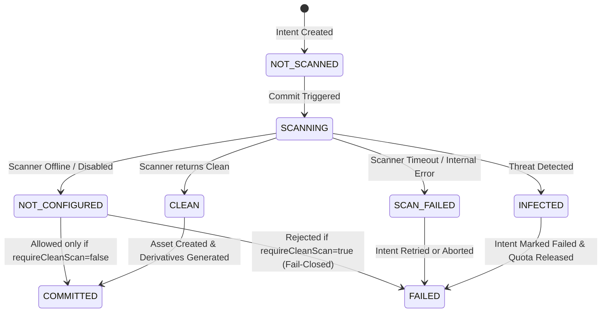

# Elégance — Production Upload Security, Malware Scanning & Quarantine Architecture

## 1. Executive Summary & Principles
In Phase 9F, the Elégance platform establishes a production-grade, fail-closed upload security subsystem. All incoming binary files enter an isolated quarantine boundary (`quarantine/studios/{studioId}/{uploadIntentId}.*`) and can never be committed to canonical storage or generated as public derivatives until passing comprehensive structural checks and malware inspection.

Key Architectural Guarantees:
1. **Isolated Quarantine-First**: Pre-signed and direct uploads place raw binary payloads exclusively into a quarantine storage space.
2. **Provider-Agnostic Scanner Port**: Upload scanning is decoupled behind the `MalwareScanner` domain port, supporting `FakeMalwareScanner` for deterministic CI/local development, `DisabledMalwareScanner` for environments without scanner infrastructure, and live enterprise engines (e.g., ClamAV, AWS GuardDuty).
3. **Truthful Status Lifecycle**: The platform never reports `CLEAN` unless an active scanner verified the file. If scanning is disabled, status is recorded truthfully as `NOT_CONFIGURED` or `NOT_REQUIRED`.
4. **Fail-Closed Production Policy**: When `app.media.security.require-clean-scan=true` (default in production), any missing scanner, transient scanner error, or infected detection aborts the commit, prevents media asset creation, and fails closed.
5. **Slot-Preserving Replacement Safety**: When replacing existing photos, if the replacement file fails image validation or malware scanning, the existing canonical asset and its public derivatives remain completely untouched.
6. **Quota Accounting Integrity**: Quota reservations from pending upload intents are automatically cleared on scan failure or malware detection by transitioning the intent to `FAILED`.

---

## 2. Scan Status State Machine



### Scan Status Values (`upload_intents.scan_status`):
- `NOT_SCANNED`: Upload intent created; binary uploaded to quarantine or awaiting upload.
- `PENDING`: Upload intent ready for asynchronous or synchronous security evaluation.
- `SCANNING`: Scan actively running against quarantine payload.
- `CLEAN`: Binary verified free of malicious code, decompression bombs, and polyglots.
- `INFECTED`: Known threat signature or malicious executable detected. Payload blocked.
- `SCAN_FAILED`: Transient scanner failure, network timeout, or scanner process error.
- `NOT_CONFIGURED`: Scanner infrastructure is unconfigured/offline.
- `NOT_REQUIRED`: Internal/trusted administrative payload where scanning is explicitly waived by policy.

---

## 3. Database Schema & Flyway Migration (`V039`)

### Enhanced Columns on `upload_intents`:
- `scan_status varchar(32) NOT NULL DEFAULT 'NOT_SCANNED'`
- `scan_attempt integer NOT NULL DEFAULT 0`
- `scan_requested_at timestamptz NULL`
- `scanned_at timestamptz NULL`
- `scanner_provider varchar(64) NULL`
- `threat_name varchar(128) NULL`

### Audit Ledger: `media_security_scans`:
```sql
CREATE TABLE IF NOT EXISTS media_security_scans (
    id uuid NOT NULL DEFAULT uuidv7() PRIMARY KEY,
    upload_intent_id uuid NOT NULL REFERENCES upload_intents(id) ON DELETE CASCADE,
    studio_id uuid NOT NULL REFERENCES designer_studios(id) ON DELETE CASCADE,
    storage_key varchar(512) NOT NULL,
    scanner_provider varchar(64) NOT NULL,
    engine_version varchar(64) NULL,
    scan_outcome varchar(32) NOT NULL CHECK (scan_outcome IN ('CLEAN', 'INFECTED', 'ERROR', 'UNAVAILABLE')),
    threat_classification varchar(128) NULL,
    duration_ms bigint NOT NULL DEFAULT 0 CHECK (duration_ms >= 0),
    scanned_at timestamptz NOT NULL DEFAULT now(),
    error_message text NULL,
    metadata jsonb NULL
);
```

### Row Level Security (RLS):
- Isolated per tenant studio via `current_setting('app.current_studio_id', true)`.
- Global visibility permitted for platform administrators (`current_setting('app.is_admin', true) = 'true'`).

---

## 4. Pre-Commit Validation Pipeline

Before moving bytes from quarantine to private canonical storage:
1. **Size Verification**: Validates expected byte range (1 byte to 25 MB max).
2. **Magic Byte Signature Inspection**: Verifies binary headers strictly match JPEG (`FF D8 FF`), PNG (`89 50 4E 47 0D 0A 1A 0A`), or WebP (`52 49 46 46...57 45 42 50`). SVGs, executables, scripts, and polyglots are rejected immediately.
3. **Decompression Bomb Defense**: Dimension limits capped at `10,000 x 10,000 px` and total resolution limited to 50 Megapixels.
4. **Malware & Threat Inspection**: Invokes `MediaSecurityScanService.scanAndEnforce(...)`.
5. **Metadata Stripping**: Generated derivatives (WebP/JPEG) are stripped of GPS EXIF tags; original is saved to private storage.

---

## 5. Failure Recovery & Replacement Isolation

1. **Infected Uploads**:
   - Throws `BadRequestException` (`MALWARE_DETECTED`).
   - Marks `upload_intents.status = 'FAILED'`, clearing pending quota.
   - Quarantine file is retained in isolated storage for forensic analysis or auto-purged by lifecycle policy.
2. **Slot-Preserving Replacement**:
   - In `MediaService.replaceMedia(...)`, the existing canonical original and public derivatives are left intact until the replacement payload passes image validation and malware scanning.
   - If infected, the replacement attempt is aborted and the live photo is not impacted.

---

## 6. Verification Results
- **PostgreSQL RLS Suite**: 41 / 41 PASS (`-Dtest=*PostgreSql*Test`), including `PostgreSqlMediaMalwareSecurityTest` and all legacy suites.
- **Backend Test Suite**: 516 / 516 PASS (`mvnw.cmd test`), covering all domain services, quotas, security policies, and malware unit tests.
- **Frontend Test Suite**: 52 test files / 368 tests PASS (`vitest run`).
- **Frontend Typecheck**: TypeScript `tsc --noEmit` passed with 0 errors.
- **Frontend Lint**: ESLint passed with 0 errors.
- **Next.js Production Build**: `next build` compiled all 51 static/dynamic pages cleanly.
