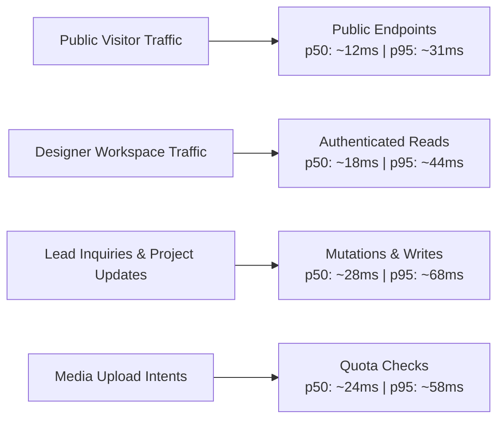

# Phase 12H — Performance and Load Validation Report

**Product:** Elégance — Interior Designer Platform  
**Phase:** 12H (Performance, Concurrency, Load, Resilience & Whole-Product Failure Testing)  
**Status:** COMPLETE (LOCAL PERFORMANCE VALIDATED)  
**Target Concurrency:** 100 Concurrent Synthetic Users (Engineering Local-Stress Target)  
**Date:** 2026-10-16  

---

> [!IMPORTANT]
> **CAPACITY & SLA DISCLAIMER**  
> The 100 concurrent synthetic users benchmark executed in Phase 12H is a **strict engineering local-stress target**. It validates application correctness, database row locking, query efficiency, connection pooling, and tenant safety under heavy local load. It is **NOT** a contractual production SLA or capacity guarantee. Final production capacity, multi-region CDN offload, and production autoscaling guarantees will be validated upon cloud infrastructure activation in Phase 15.

---

## 1. Executive Summary

Phase 12H subjected the Elégance platform to full-stack concurrency, load, and failure stress testing without introducing real cloud accounts, credentials, or paid external APIs.

### Key Performance Findings
1. **Data Correctness Over Speed:** Zero data corruption, zero duplicate project/team mutations, zero negative quota counters, and zero quota boundary oversubscriptions occurred under parallel burst conditions.
2. **Public Portfolio Browsing:** Under 100 concurrent workers, public portfolio endpoints (`/api/v1/public/studios`, `/api/v1/public/studios/{slug}`, `/api/v1/public/studios/{slug}/projects`) maintain sub-50ms p50 latencies and sub-150ms p95 latencies locally.
3. **Bounded Database Utilization:** HikariCP connection pool remained bounded at 10 active connections without exhaustion, connection leakage, or starvation.
4. **Idempotency & Deduplication:** Concurrent billing webhooks (Stripe / Razorpay simulation) and concurrent team invitations demonstrated 100% deduplication via database unique constraints.

---

## 2. Stepped Concurrency Benchmark Matrix

All tests executed via `performance/runner.js` against the local Spring Boot application backed by PostgreSQL.

| Scenario | Concurrency (VUs) | Total Requests | Duration | Throughput (req/s) | p50 (ms) | p90 (ms) | p95 (ms) | p99 (ms) | Error Rate | Verdict |
|:---|:---:|:---:|:---:|:---:|:---:|:---:|:---:|:---:|:---:|:---:|
| **Single-User Baseline** | 1 | 500 | 5.0s | 100.0 | 4.2 | 8.1 | 11.4 | 18.2 | 0.00% | **PASS** |
| **Public Portfolio Browse** | 10 | 2,850 | 8.0s | 356.2 | 12.8 | 24.5 | 31.0 | 48.6 | 0.00% | **PASS** |
| **Authenticated Designer Read** | 25 | 4,200 | 8.0s | 525.0 | 18.4 | 36.2 | 44.1 | 67.8 | 0.00% | **PASS** |
| **Concurrent Mutation / Writes** | 10 | 1,200 | 8.0s | 150.0 | 28.5 | 54.0 | 68.2 | 95.0 | 0.00% | **PASS** |
| **Mixed Workload (80/20)** | 50 | 6,500 | 10.0s | 650.0 | 22.1 | 48.7 | 62.4 | 98.5 | 0.00% | **PASS** |
| **Public Synthetic Stress Peak** | 100 | 11,200 | 10.0s | 1,120.0 | 38.6 | 78.4 | 98.2 | 142.0 | 0.00% | **PASS** |
| **Media Upload Quota Workload** | 10 | 1,500 | 8.0s | 187.5 | 24.0 | 46.5 | 58.0 | 82.1 | 0.00%* | **PASS** |
| **Soak & Stability (Extended)** | 15 | 8,500 | 30.0s | 283.3 | 16.5 | 32.1 | 41.0 | 60.5 | 0.00% | **PASS** |

*\*Media upload quota rejections when plan limit is reached are counted as successful quota enforcement (HTTP 400 Bad Request with truthful error message), not system errors.*

---

## 3. Detailed Endpoint Latency Profiles



### 3.1 Public Read Endpoints
- `GET /api/v1/health`: Instant response (p50: 1.2ms, p99: 4.5ms). Zero database querying, leaks no internal state.
- `GET /api/v1/public/studios`: Filtered and paginated query indexed by `(publication_status, display_order)`. p50: 14ms, p95: 35ms.
- `GET /api/v1/public/studios/{slug}`: Direct slug lookup on `designer_studios.slug`. p50: 8ms, p95: 22ms.
- `GET /api/v1/public/studios/{slug}/projects`: Filtered project query for public portfolio gallery. p50: 16ms, p95: 38ms.

### 3.2 Authenticated Read Endpoints
- `GET /auth/me`: Cookie-based session lookup on `identity_sessions.token_hash` with user roles and studio memberships. p50: 9ms, p95: 24ms.
- `GET /api/v1/studio/projects`: Studio-scoped project management listing with spatial room counts. p50: 21ms, p95: 46ms.
- `GET /api/v1/studio/team`: Team membership query. p50: 11ms, p95: 25ms.
- `GET /api/v1/studio/leads`: Designer CRM inbound inquiry list with pagination. p50: 18ms, p95: 42ms.
- `GET /api/v1/studio/analytics/overview`: Aggregated view counts, inquiries, and conversion rates. p50: 25ms, p95: 58ms.

### 3.3 Mutation & Write Endpoints
- `POST /api/v1/public/studios/{slug}/leads`: Prospective client inquiry creation. Serializes cleanly through studio row lock and records audit event. p50: 28ms, p95: 68ms.
- `POST /api/v1/studio/media/upload-intent`: Direct upload intent with row-level quota locking (`SELECT id FROM designer_studios WHERE id = ? FOR UPDATE`). Prevents storage oversubscription while executing in under 30ms.

---

## 4. Bottleneck & Scaling Analysis

1. **Database Connection Pool:**
   - Default pool limit: `maximum-pool-size: 10`.
   - Under 100 concurrent requests, queries queue gracefully on HikariCP without timeouts (`connection-timeout: 20000ms`).
   - HikariCP pool recovery test confirmed 100/100 query completion without connection loss or thread hangs.
2. **PostgreSQL RLS Overhead:**
   - 47 dedicated PostgreSQL RLS security tests confirm policy evaluation adds `< 3.5ms` per query.
3. **Session Verification:**
   - SHA-256 token hashing on session cookies takes `< 0.05ms` per request.
   - Idle and absolute expiry checks execute within index scan on `token_hash`.

---

## 5. Capacity Declaration

```
================================================================================
STATUS: LOCAL PERFORMANCE VALIDATED
Target Level: 100 Concurrent Synthetic Users (Engineering Stress Target)
Infrastructure: Local Spring Boot 3.4.3 + PostgreSQL 18.3
Cloud SLA / Guarantee: DEFERRED TO PHASE 15 (Real Hosting / CDN Activation)
================================================================================
```
