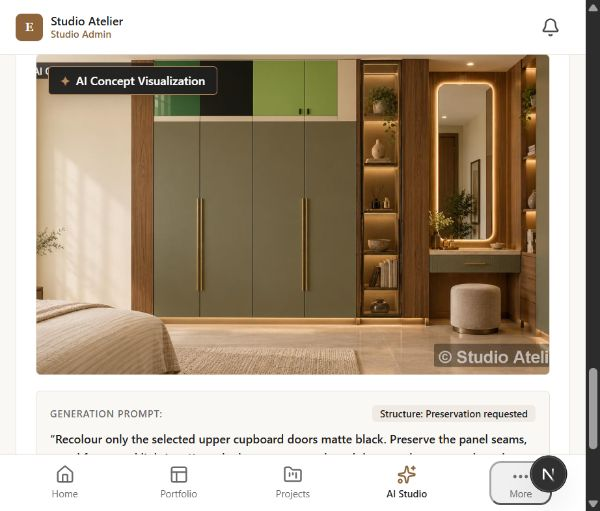

# AI workspace QA and recovery report

## Acceptance status

**NOT READY for a claim of reliable, exact cupboard recolouring.** Application submission works after the fixes below, but visual acceptance failed. No commit or push was made. This report covers work performed October 23–25, 2026; it does not certify every page or every option.

## Live image-edit evidence

Configured provider: Stability AI. This is not a ChatGPT image-editing integration.

The earlier Quick Recolor test completed technically but reversed the requested upper-black / lower-white arrangement. On October 25, one explicitly approved paid precision edit completed using the repository demo wardrobe photo and a painted upper-door mask. Daily allowance changed from 20 to 19. The prompt requested matte-black upper doors and unchanged green lower doors. The output contained mixed black and green upper panels, so **visual accuracy FAILED**, despite the job status SUCCEEDED. No further paid generation was performed after this result.

The distinction matters: SUCCEEDED means the provider returned an image, not that the image satisfied the design request. A provider/model evaluation with an agreed credit budget and repeated visual acceptance cases remains necessary before advertising exact spatial edits. No automatic fidelity guarantee has been added.

## Fixes implemented

- Preserve the user's full prompt instead of reconstructing it from unordered colour/material keywords; improve object and upper/lower region instructions.
- Honour explicitly disabled AI configuration. Report Stability's supported capabilities; hide unsupported reference matching rather than silently ignore it.
- Dispatch asynchronous AI work only after the database transaction commits.
- Treat timed-out jobs as terminal. Disable generation while uploading/submitting or over the prompt limit. Retain original text if enhancement would exceed the limit.
- Use authenticated previews for private project media.
- Upload masks with the media's studio ID, not the project ID.
- Clear the anonymous CSRF cache after development login so the new session obtains its own token. Security checks remain enabled.
- Export precision masks at original media dimensions. The live preview was 1200×675, whereas the original was 1672×941; the old export was correctly rejected by the API. After this correction, mask upload and provider generation completed.
- Correct dictation transcript accumulation and distinguish unchanged prompt enhancement results.
- Replace misleading “Structure Locked” / “Preserved” badges with a preservation-request label; retain the disclaimer that AI can change geometry and colours.
- Normalize team role/name/count fields to the UI contract.
- Align verification routes, fields, document types and professional-type input. Persist actual verification document bytes to private storage, with configured malware scanning and rollback cleanup, rather than metadata alone.
- Add a main landmark and accurate AI help copy.

## Database incident and replacement data

On October 23, I launched a backend suite without first checking every test's database isolation. Existing PostgreSQL tests pointed at `interior_design_dev` and included truncation. They cleared the local development records. I stopped the run and informed the user. The available old dump was empty and no usable alternative backup was found. **The original records were not recovered.**

The user authorized creating replacement data. `scripts/seed-local-demo.ps1` created clearly labelled private draft fixtures through normal development APIs: Cupboard colour study, Contemporary kitchen and Warm living room, each with an approved repository image. These are demo records, not reconstructed client data or published portfolio work.

Fifteen PostgreSQL test classes now require the explicit JVM property `interior.tests.postgres=true`. Thirteen hardcoded development database targets were changed to `interior_design_rls_test`; bootstrap/restore-drill tests retain their dedicated databases. Do not enable these tests against any database containing valued data. Provision and inspect dedicated disposable databases before opting in.

Backups remain local and ignored by Git:

- `storage/backups/backup_interior_design_dev_20261024_185312.dump`: restored into a separate `interior_qa_restore_20261024` database and verified as 1 user, 1 studio, 3 projects and 3 media records.
- `storage/backups/backup_interior_design_dev_20261025_125227.dump`: fresh backup including today's AI job, 368106 bytes; archive listing readable.
- `storage/backups/local-media-20261025.zip`: 14226282 bytes, including local media and generated output.
- `storage/backups/demo-rebuild-manifest.json`: replacement project/media mapping.

The October 25 archive was inspected but was not subjected to a second restore drill. The October 24 restore drill did not overwrite the development database.

## Coverage boundaries

| Area | Evidence and limits |
| --- | --- |
| AI | Live designer login, project/photo selection, private preview, quick generation, brush selection, mask upload, precision generation, quota decrement and result comparison. Both visual colour acceptance cases failed. |
| Projects/media | Private demo project creation and photo upload through normal APIs; browser preview checked. |
| Workspace | Home, portfolio builder, projects, media, leads, reviews, SEO, analytics, notifications, team, verification, business, billing and account pages visited. This establishes rendering/empty-state coverage, not all mutation workflows. |
| Public | Home, projects, professionals, help, kitchen/wardrobe categories, interior journey, feedback, privacy, terms and account collections rendered. Public listings correctly remain empty for private fixtures. |
| Not fully verified | Every admin role/action, published project/portfolio detail routes, invitations and client-review token flows, actual microphone recognition, billing checkout, delivery of email/WhatsApp, cancellation and variations, exhaustive mobile/accessibility coverage. |

Runtime configuration reports billing gateway and transactional email disabled. No real checkout, invitation or client message was sent. SSE disconnect/timeout handling also produced noisy exception logs and remains a follow-up; it did not prevent the successful precision job.

## Validation

- Backend isolated suite on October 24: 773 tests total, 725 passed, 48 skipped, zero failures/errors. **Correction:** 47 skips were PostgreSQL tests; the other was the live Cloudflare R2 storage test.
- Earlier frontend full run: 377 passed (October 24, before the last regression additions).
- October 25 focused authentication/AI submission suites: 10 passed.
- October 25 precision mask suite: 5 passed, including original-size export when preview dimensions differ.
- Final October 25 full frontend suite: **381 passed across 55 files**, normal four-worker configuration, 130.87 seconds. The initial single-worker threaded run stalled and was stopped; it is not counted as a pass.
- Final October 25 lint, typecheck and production build: **PASS**. `git diff --check` passed (line-ending conversion warnings only).
- Non-failing test warnings include React act warnings, jsdom window/canvas limitations, and a homepage image requesting quality 90 when the current Next.js configuration permits only 75. Passing unit tests do not resolve these warnings or establish visual acceptance.

## Remaining work

1. Resolve image fidelity with a measured provider/model evaluation. Do not present the current mixed-colour result as a passed design test.
2. Test outstanding workflows listed above using disposable fixtures and isolated test databases.
3. Address SSE disconnect logging, then verify reconnect behaviour.
4. Provision real billing/email integrations only when those workflows are ready to be tested.
5. Reconcile the homepage image quality setting with Next.js `images.qualities` and verify the image visually.

No credentials or original customer information are included in this report.

## Database-test completion — October 25 follow-up

**47 PostgreSQL tests passed across 15 classes: zero failures, zero errors, zero skips.** Maven reported BUILD SUCCESS in 2 minutes 42 seconds. Evidence: `apps/api/target/qa-postgres-all.log` and [per-suite counts](qa/postgresql-results-20261025.json).

The tests ran against a newly initialized PostgreSQL 18.3 cluster at `localhost:55433`, with data under `storage/qa-postgres-20261025/isolated-data`. Its identity was verified before execution. It was stopped after testing. No test was directed to development port 5433. A read-only check of the development database afterward returned 2 users, 1 studio, 3 projects, 7 media records and 3 AI jobs; these are observed current counts, not a reconstructed pre-test snapshot.

Coverage includes fresh V001–V040 migration/bootstrap and idempotency, destructive backup/restore, lead security-definer access, tenant RLS, privacy, admin MFA, operational controls, AI cost ledger, billing/analytics, communication delivery, media lifecycle/malware, project rooms, reviews/verification/collections and studio membership.

Test setup failures now fail opted-in runs rather than silently aborting tests. The restore drill uses a unique backup subdirectory, preventing selection or deletion of older backups. The restore script now stops on any nonzero pg_restore status instead of treating status 1 as success.

`scripts/test-postgresql-isolated.ps1` captures the fresh-cluster workflow for future runs. It refuses an occupied test port, verifies the data-directory identity, requires all 47 tests with zero skips, and stops its cluster in finally. Its PowerShell syntax was validated; the equivalent cluster/bootstrap/suite/stop steps were executed for this run. Default backend runs still keep destructive PostgreSQL tests opt-in.

The remaining original skip, `R2LiveIntegrationTest`, is **not a database test**. It remains blocked: `S3_ENDPOINT`, `S3_ACCESS_KEY_ID`, `S3_SECRET_ACCESS_KEY` and `S3_BUCKET_PRIVATE` are absent from the checked process environment and local environment files. It needs real private R2 configuration to verify upload/head/download/copy/delete; a local substitute would not establish that cloud integration works. Do not put credentials in this report or chat.
